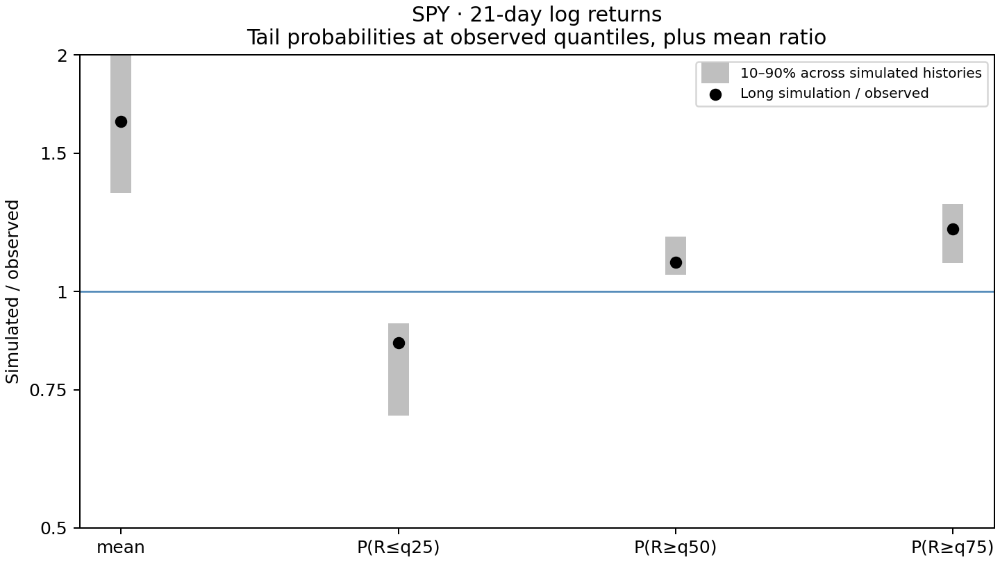

# Student-t EGARCH

    rₜ = μ + √hₜ zₜ
    log hₜ = ω + mₜ
    mₜ = βmₜ₋₁ + α(|zₜ₋₁| − E|zₜ|) − γzₜ₋₁
    zₜ ∼ √((ν−2)/ν) Tν, iid

# Run it

    python3 -m venv .venv
    .venv/bin/pip install -r requirements.txt
    .venv/bin/python play.py

All code in play.py, settings at the top. Python 3.10–3.13.
Daily MLE only, first 91 calendar days used for filter warmup.

Overlapping 21-day log-return sums. Plot simulated/observed ratios for the mean and tail
probabilities at fixed observed quantiles, P(R≤q25), P(R≥q50), P(R≥q75).
Observed probabilities are measured from data, approximately 0.25, 0.5, 0.25.
10–90% bands across 100 simulated histories of observed length, fitted parameters fixed.
Point estimates from a separate 100,000-day simulation, no shock clipping.

    moment_error = mean(((simulated-observed)/(trial_q90-trial_q10))**2)

Student-t EGARCH has no finite unconditional absolute-return mean for nonzero α or γ.
The displayed mean is a finite-sample diagnostic. Tail probabilities remain well defined.

spy.csv is the stored SPY USD close series from bc-prices, SPY:ARCX/price/close,
2004-12-31 to 2026-09-30, as used by garch/play.jl. No additional dividend adjustment.
Output: LLH and diagnostics in terminal, results/moments.csv and results/moments.png.
Model formula: results/model.png.
